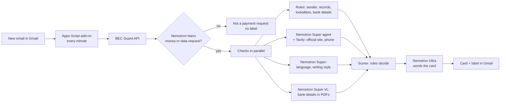

# BEC Guard

**Checks payment requests in email before you pay.** BEC Guard sits inside Gmail. When an email asks for money or
data, it tells the person about to pay what doesn't add up, and who to call before they do. Built for the
Nebius × NVIDIA Global AI Hackathon (Best Apps and Agents track) with NVIDIA Nemotron models on Nebius Token Factory.

- **Live demo:** _TBD (deploy pending)_ · **Video:** _TBD_
- **License:** [MIT](LICENSE)
- **Built during the hackathon:** the whole project was created during the submission period; the commit history
  shows the dates.

## The problem

Business email compromise (BEC) cost victims **$3,046,598,558** in 2025, the second-largest loss of any cybercrime
after investment fraud ([FBI Internet Crime Report 2025](https://www.ic3.gov/AnnualReport/Reports/2025_IC3Report.pdf),
page 8). Spam filters stop most junk, but BEC emails often contain no
link and no malware. They are a plain request to pay a new account, and the most damaging ones come from a real,
authenticated mailbox that has been taken over.

BEC Guard covers the three ways the money gets stolen:

| | What happens | What BEC Guard checks |
|---|---|---|
| 1 | **A stranger pretends to be someone you pay**: lookalike address, copied name, a company you've never paid | Sender vs your vendor records and staff directory, lookalike domains, domain age, the company's official website and phone (Nemotron Super agent + web search) |
| 2 | **Your vendor's real mailbox is hacked**: every sender check passes | Bank details (also inside PDFs, via Nemotron Super VL) vs the account you've always paid, payment method change, pressure and secrecy, writing style vs the vendor's past emails |
| 3 | **Your own mailbox is hacked** | New filters and forwarding, "send mail as" and POP, bank details sent outside from your account, sent mail deleted soon after, payment or security email deleted, mail placed without delivery. A banner shows in Gmail and an email goes to the compliance contact on the server, which the mailbox owner can't change |

The result is a card next to the email: **Verify before paying**, **Looks unusual** or **No issues found**, with
three sections (the sender, the company, the request) and the evidence behind each line, such as the last paid
invoices or the official website page used. Risky emails also get a Gmail label.

## How it works



Design rules that hold everywhere:

- **A rule decides, never a model.** Models produce facts; a deterministic scorer turns facts into the decision.
- **Phone numbers to call come only from trusted sources**: your vendor records, your staff directory, or the
  company's official website found by the agent. A number written in the email is compared, never offered.
- **Model output is checked by code.** A reworded line from Ultra is used only if every address, phone number,
  amount and number in it appears in the original rule wording; otherwise the rule wording stays.
- **Bank details are never learned from email.** They come from the vendor records, because an attacker already in a
  thread would poison that history.
- BEC Guard only adds labels. It never moves, deletes or forwards mail.

## NVIDIA Nemotron on Nebius Token Factory

All model calls go to Nebius Token Factory through one OpenAI-compatible endpoint and one key; the request's
`model` field picks the model. Each step uses the smallest model that does the job well:

| Step | Model | Why this model |
|---|---|---|
| Is this a money or data request? (every email) | `nvidia/NVIDIA-Nemotron-3-Nano-30B-A3B` | Fast and cheap; most email stops here |
| Official website and phone lookup (tool-calling agent with Tavily web search) | `nvidia/nemotron-3-super-120b-a12b` | Chooses its own searches; output passes code guardrails |
| Urgency, secrecy and request type; writing style vs past emails (incoming and sent) | Nemotron 3 Super | Needs judgement |
| Explaining a suspicious mailbox rule | Nemotron 3 Super | One-off, cached per rule |
| Bank details inside PDF and image attachments | `nvidia/Nemotron-3.5-Super-VL` | Wire instructions often hide in PDFs |
| Wording the card in plain language; the takeover summary for compliance | `nvidia/Nemotron-3-Ultra-550b-a55b` (fallback: Super) | Best wording, used only when something needs checking |

**Measured (2026-10-27, real models, 7 sample emails):** all 7 got the expected decision. Average 7.8 s per email
(6.0–11.4 s), about $0.003 per email at third-party list prices (our estimate from token counts; Super VL priced as
Super). A non-money email costs about $0.0001 (Nano only). Live Gmail emails with a real web search took 13–18 s.

**Other services:** Tavily web search (the agent's tool), RDAP (domain registration age), dnstwist (lookalike
domains), Gmail API via Apps Script. Hosting on Nebius Serverless Endpoints: _pending_.

## Try it

- **Website** (`/`): Home (the story of one scam), **Try it** (sample inbox, write your own test email with a
  simulated delivery result) and **Production** (the plan beyond the hackathon).
  Sample companies and people are fictional, web and domain facts in the sample inbox are simulated, and the AI
  analysis is real. The mailbox-takeover checks need a real mailbox, so they are shown in the video. Judges: if
  you'd like to see BEC Guard or use it inside Gmail yourself, we can share the login details of the Gmail test
  accounts used in the video. Please let us know through Devpost.
- **Gmail:** the add-on installs as an Apps Script test deployment on your own Gmail account. See
  [gmail-addon/README.md](gmail-addon/README.md). Demo scenarios and test emails are in
  [docs/DEMO_SCENARIOS.md](docs/DEMO_SCENARIOS.md) and [demo-emails/](demo-emails/).

## Run it locally

Requirements: Python 3.14 (what we developed and tested on), Node 22.18+.

```bash
python -m venv .venv && .venv/bin/pip install -r requirements.txt
cp .env.example .env              # MOCK_MODE=true works without any keys
cd frontend && npm ci && npm run build && cd ..
.venv/bin/uvicorn app.main:app --port 8000
# open http://127.0.0.1:8000
```

**Real models:** in `.env`, set `NEBIUS_API_KEY` (Token Factory), `TAVILY_API_KEY` and `MOCK_MODE=false`.
`/healthz` shows which mode is running. Public endpoints are rate limited per visitor and by a daily budget
(`RATE_LIMIT_*`, `DAILY_ANALYSIS_BUDGET`), because every analysis spends credits.

**Gmail add-on:** set `BEC_API_KEYS=<tenant>:<key>` in `.env` (generate a key with
`python -c "import secrets; print(secrets.token_urlsafe(32))"`), expose the server over HTTPS, then follow
[gmail-addon/README.md](gmail-addon/README.md). Company records for a tenant are in `data/tenants/<tenant>/`
(format: [docs/DATA_SOURCES.md](docs/DATA_SOURCES.md)).

**Development:** UI with hot reload: `cd frontend && npm run dev` (proxies the API to :8000).

**Tests:**

```bash
.venv/bin/pytest -q                                   # backend (mock mode, no keys needed)
node --test gmail-addon/tests/logic.test.js frontend/tests/compose.test.mjs
cd frontend && npm run typecheck
```

## Repository layout

| Path | What |
|---|---|
| `app/phase_a/` | Email analysis: parsing, gate, sender/org/content checks, web agent, scorer, card |
| `app/phase_b/` | Mailbox checks: rules and forwarding, account takeover |
| `app/integration_api.py` | `/api/v1` for mail-client integrations (per-tenant API key) |
| `app/clients/` | Token Factory, Tavily, RDAP clients |
| `gmail-addon/` | The Gmail add-on (Apps Script) |
| `frontend/` | Website (React, Vite, Tailwind), served by FastAPI |
| `data/`, `scenarios/` | Fictional sample company, records and sample emails |
| `fixtures/` | Saved model and web responses for mock mode and tests |

## Limitations

- The add-on is an unpublished Apps Script test deployment; checks run every minute (the Apps Script minimum), not
  on push.
- Server state (alerts, takeover history) is held in memory and lost on restart.
- Vendor records are JSON files, not an accounting-system sync.
- Takeover checks see only what the mailbox shows: no sign-in logs, and an intruder could remove the add-on. The
  production plan reads admin audit logs on the server to close this.
- Model judgements (writing style, tone) can be wrong; they are low-weight and never decide alone.

The production plan (Marketplace add-on and Outlook add-in, push events, audit logs, accounting sync, a payment gate
in bill pay) is on the website's **Production** page.

## Feedback on Nebius Token Factory and NVIDIA Nemotron

- **One endpoint, one key, every model.** Switching between Nano, Super, Super VL and Ultra is a change to the
  `model` field, which made per-step model routing simple to build and test.
- **Tool calling on Nemotron Super worked first time** with OpenAI-style `tools`: the agent picked its own searches,
  used 2 tool calls and returned valid JSON. It didn't always use optional tool arguments we suggested (for example
  restricting a search to one domain), so we kept code guardrails on its output.
- **Nemotron Super VL read a bank-details PDF fully correctly** (bank, routing, account, amount, invoice and PO) on
  the first try.
- **Structured output was reliable:** valid JSON on the first attempt in our first real runs.
- **What would have helped:** a list of which models support tool calling and vision in the docs (we found out by
  testing), and model IDs listed in the docs (we confirmed them via `/v1/models`). Latency varied: one Nano call took
  8.8 s against a usual ~1 s, so every step falls back to a safe default when a call fails.
- **Nebius AI Cloud:** the free trial was suspended when we started, so hosting there needed credits or a card;
  Token Factory itself worked with the hackathon credits from day one.
