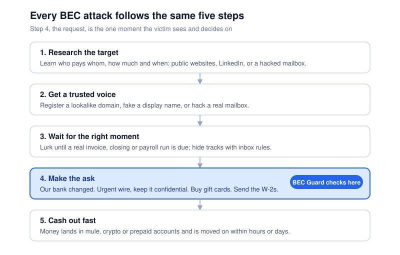
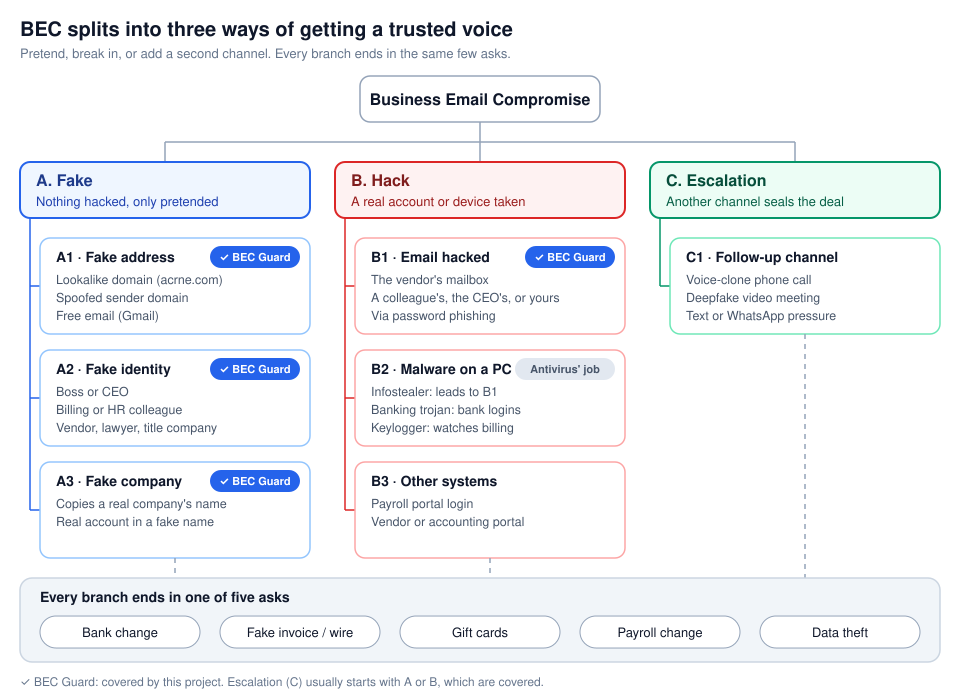
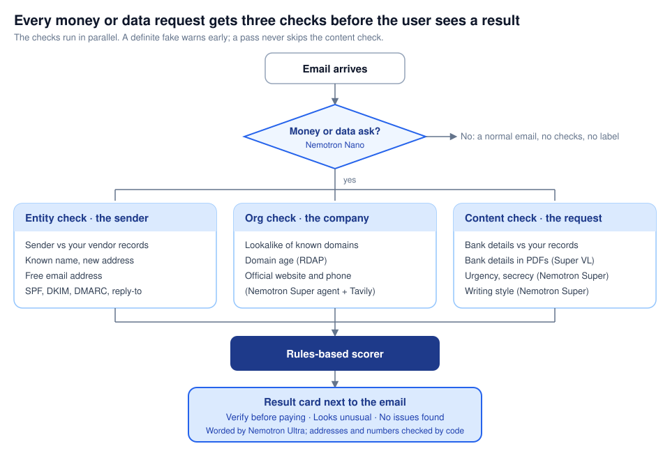
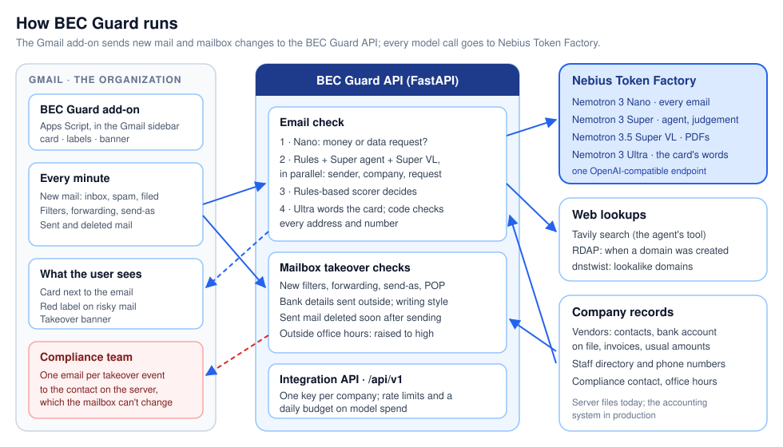

# BEC Guard

**Checks payment requests in email before you pay.** BEC Guard sits inside Gmail. When an email asks for money or
data, it tells the person about to pay what doesn't add up, and who to call before they do. Built for the
Nebius × NVIDIA Global AI Hackathon (Best Apps and Agents track) with NVIDIA Nemotron models on Nebius Token Factory.

- **Live demo:** _TBD (deploy pending)_ · **Video:** _TBD_
- **License:** [MIT](LICENSE)

## The problem

Business Email Compromise (BEC) is a scam where a criminal pretends to be someone you already trust (a vendor, your
CEO, a colleague, a lawyer) and emails a normal-looking request to send money or sensitive data. The money goes to an
account the criminal controls, and the request usually arrives right when a real payment is expected. The FBI also
calls it Email Account Compromise, because many attacks come from a real mailbox that has been hacked, not a fake one.

It is one of the most expensive crimes the FBI tracks
([FBI Internet Crime Report 2025](https://www.ic3.gov/AnnualReport/Reports/2025_IC3Report.pdf)):

- **$3,046,598,558** lost to BEC in 2025, second only to investment fraud (page 8).
- **24,768** complaints, so about **$123,000 per complaint** on average.
- About **$8.8 billion** lost in the last three years, 2023 to 2025 (page 26).

These are only the reported cases.

### How it happens

Attacks look different on the surface, but almost all of them follow one pattern: study the target, borrow a trusted
identity, wait for a real payment, then ask for one small change.



### Three real cases

| Case | Loss | What happened |
|---|---|---|
| [City of Liberty, Texas](https://www.fox26houston.com/news/city-liberty-loses-approximately-600k-fraudulent-wire-transfer) (Oct 2026) | about $600,000 | An email from a lookalike of a vendor's domain asked for payment of a bill the city really owed, for the same amount. The receiving bank flagged it only after the wire went out. |
| [Alameda County Transportation Commission, California](https://sfstandard.com/2026/10/08/alameda-county-transportation-commission-fraud-payments/) (Sep 2024, in court 2026) | $500,000 | The scammer hacked a contractor's real mailbox, replied in an existing thread with four staff, asked them to hold the next payment, and gave new bank details. |
| [Arup, Hong Kong office](https://keyt.com/news/national-world/cnn-world/2024/02/03/finance-worker-pays-out-25-million-after-video-call-with-deepfake-chief-financial-officer) (Jan 2024) | about $25.6 million | A finance worker doubted a "confidential transaction" email, then joined a video call where the CFO and colleagues were all deepfakes. He sent 15 transfers to 5 accounts. |

## Solution analysis

I started by breaking the problem down. Every BEC attack answers two questions: how does the attacker get a trusted
voice, and what do they ask for? There are three ways to get the voice: pretend (fake), break in (hack), or add a
second channel to remove doubt (escalation). Whatever the route, it ends in one of five asks.



A few decisions came out of this:

- **Who it's for:** the accounts payable clerk or bookkeeper at a small organization (a business, a school district,
  a city, a nonprofit). That's the person who presses "pay".
- **Where it checks:** the request (step 4). It's the one moment every attack has in common, and the one moment the
  victim actually sees.
- **Sender checks are not enough.** A hacked real mailbox passes SPF, DKIM and DMARC, so what is being asked, and
  whether it matches the company's own records, matters more than who it seems to be from.
- **Verify on a channel the attacker doesn't control.** The number to call comes from your records or the company's
  official website, never from the email.
- **Malware on a PC is the antivirus's job**, so BEC Guard watches the mailbox instead: a hacked mailbox shows up as
  new filters, forwarding and odd sent mail. Escalation (deepfake calls) usually starts with a fake or hacked email,
  which is covered.

### Solution design

Every email that asks for money or data gets three checks before the user sees a result. A definite fake (a lookalike
of a vendor's domain) warns early, but a pass never skips the content check, because a hacked real mailbox passes
the sender checks.



| Check | What it looks at | Built with |
|---|---|---|
| Intent gate | Is this a payment, bank change, gift card, payroll or data request? | Nemotron Nano |
| Entity (the sender) | Sender vs vendor records and staff directory, a known name on a new address, free email, SPF/DKIM/DMARC, reply-to mismatch | Rules on the headers and the records |
| Org (the company) | Lookalike of known domains, domain age, the company's official website and phone | dnstwist, RDAP, Nemotron Super agent with Tavily web search |
| Content: invoice | Bank name, routing number, last 4 digits, payment method, amount range, invoice number and PO vs past invoices | Rules on the records; Nemotron Super VL reads PDF attachments |
| Content: language | Urgency, secrecy, unusual request type | Nemotron Super |
| Content: style | Writing style vs this sender's past emails (a soft signal) | Nemotron Super with past examples |
| Decision | Combines all findings into Verify before paying, Looks unusual or No issues found | Rules-based scorer |
| Card wording | Each finding in plain language | Nemotron Ultra, checked by code |

When the hacked mailbox is **yours**, BEC Guard also watches it every minute: new filters, forwarding, "send mail as"
and POP access, bank details sent to outside addresses, mail that doesn't read like the owner, sent mail deleted soon
after sending, and payment or security emails deleted. A banner shows on every BEC Guard card, and one email goes to
the compliance contact on the server, which the mailbox can't change. Outside office hours, every alert is raised to
high.

### The result card

The card puts the action first, uses calm language and gives one line per finding, grouped by what was checked:
⚠ what looks wrong, ℹ neutral facts, ✓ what checks out. It never says "safe to pay" or "fraud". Any bank-detail
change, or a payment to an account you have no record of, always asks you to confirm first, even when every other
check passes, following the FBI's advice to confirm payment changes by phone.

This is the card for a hacked vendor mailbox asking to pay a new account (the sample inbox's "hacked vendor thread",
shortened):

```text
Verify before paying
Before paying, confirm the new bank details with Acme Supply at (503) 555-0142 (from your vendor records),
not a number from this email.

The sender
  ✓ Writes from the address you have on file for Sam Ortiz at Acme Supply
  ✓ Confirmed as sent from ar@acmesupply.com
The company
  ✓ Acme Supply is one of your vendors (6 paid invoices on record)
  ✓ Matches Acme Supply's official website, acmesupply.com
The request
  ⚠ Asks to pay a new bank account ending 7731; your 6 paid Acme Supply invoices all went to account ending 4821
  ⚠ Asks to switch from ACH to wire
  ⚠ Sets a deadline ("Please process today"); handle with extra care
  ✓ The amount ($18,400.00) is normal for Acme Supply
  ✓ Invoice ACM-10437 is an open invoice in your records
```

Lines based on your records show the records behind them (for example the last paid invoices), and lines based on the
web link to the page that supported them.

## How it works



Design rules that hold everywhere:

- **Models find the facts; rules make the call.** The email is written by the attacker, and an email can't talk a
  fixed rule into "No issues found". The same facts always give the same decision, and every rule is tested.
- **Phone numbers to call come only from trusted sources**: your vendor records, your staff directory, or the
  company's official website found by the agent. A number written in the email is compared, never offered.
- **Model output is checked by code.** A line reworded by Ultra is used only if every address, phone number, amount
  and number in it appears in the original wording; otherwise the original wording stays.
- **Bank details are never learned from email.** They come from the vendor records, because an attacker already in a
  thread would poison that history.
- BEC Guard only adds labels. It never moves, deletes or forwards mail.

## NVIDIA Nemotron on Nebius Token Factory

All model calls go to Nebius Token Factory through one OpenAI-compatible endpoint and one key; the request's
`model` field picks the model. Each step uses the smallest model that does the job well:

| Step | Model | Why this model |
|---|---|---|
| Is this a money or data request? (every email) | `nvidia/NVIDIA-Nemotron-3-Nano-30B-A3B` | Fast and cheap; most email stops here |
| Official website and phone lookup (tool-calling agent with Tavily web search) | `nvidia/nemotron-3-super-120b-a12b` | Chooses its own searches; output passes code guardrails |
| Urgency, secrecy and request type; writing style vs past emails (incoming and sent) | Nemotron 3 Super | Needs judgement |
| Explaining a suspicious mailbox rule | Nemotron 3 Super | One-off, cached per rule |
| Bank details inside PDF and image attachments | `nvidia/Nemotron-3.5-Super-VL` | Wire instructions often hide in PDFs |
| Wording the card in plain language; the takeover summary for compliance | `nvidia/Nemotron-3-Ultra-550b-a55b` (fallback: Super) | Best wording, used only when something needs checking |

**Measured (2026-10-27, real models, 7 sample emails):** all 7 got the expected decision. Average 7.8 s per email
(6.0–11.4 s), about $0.003 per email at third-party list prices (our estimate from token counts; Super VL priced as
Super). A non-money email costs about $0.0001 (Nano only). Emails that needed a real web search took 13–36 s.

**Other services:** Tavily web search (the agent's tool), RDAP (domain registration age), dnstwist (lookalike
domains), Gmail API via Apps Script. Hosting on Nebius Serverless Endpoints: _pending_.

## Try it

- **Website** (`/`): Home (the story of one scam), **Try it** (sample inbox, write your own test email with a
  simulated delivery result) and **Production** (the plan beyond the hackathon).
  Sample companies and people are fictional, web and domain facts in the sample inbox are simulated, and the AI
  analysis is real. The mailbox-takeover checks need a real mailbox, so they are shown in the video. Judges: if
  you'd like to see BEC Guard or use it inside Gmail yourself, we can share the login details of the Gmail test
  accounts used in the video. Please let us know through Devpost.
- **Gmail:** the add-on installs as an Apps Script test deployment on your own Gmail account. See
  [gmail-addon/README.md](gmail-addon/README.md).
- **Every test we ran by hand**, in Gmail and on the website, with the emails and results:
  [demo-emails/](demo-emails/README.md). Demo scenarios: [docs/DEMO_SCENARIOS.md](docs/DEMO_SCENARIOS.md).

## Run it locally

Requirements: Python 3.14 (what we developed and tested on), Node 22.18+.

```bash
python -m venv .venv && .venv/bin/pip install -r requirements.txt
cp .env.example .env              # MOCK_MODE=true works without any keys
cd frontend && npm ci && npm run build && cd ..
.venv/bin/uvicorn app.main:app --port 8000
# open http://127.0.0.1:8000
```

**Real models:** in `.env`, set `NEBIUS_API_KEY` (Token Factory), `TAVILY_API_KEY` and `MOCK_MODE=false`.
`/healthz` shows which mode is running. Public endpoints are rate limited per visitor and by a daily budget
(`RATE_LIMIT_*`, `DAILY_ANALYSIS_BUDGET`), because every analysis spends credits.

**Gmail add-on:** set `BEC_API_KEYS=<tenant>:<key>` in `.env` (generate a key with
`python -c "import secrets; print(secrets.token_urlsafe(32))"`), expose the server over HTTPS, then follow
[gmail-addon/README.md](gmail-addon/README.md). Company records for a tenant are in `data/tenants/<tenant>/`
(format: [docs/DATA_SOURCES.md](docs/DATA_SOURCES.md)).

**Development:** UI with hot reload: `cd frontend && npm run dev` (proxies the API to :8000).

**Tests:**

```bash
.venv/bin/pytest -q                                   # backend (mock mode, no keys needed)
node --test gmail-addon/tests/logic.test.js frontend/tests/compose.test.mjs
cd frontend && npm run typecheck
```

## Repository layout

| Path | What |
|---|---|
| `app/phase_a/` | Email analysis: parsing, gate, sender/org/content checks, web agent, scorer, card |
| `app/phase_b/` | Mailbox checks: rules and forwarding, account takeover |
| `app/integration_api.py` | `/api/v1` for mail-client integrations (per-tenant API key) |
| `app/clients/` | Token Factory, Tavily, RDAP clients |
| `gmail-addon/` | The Gmail add-on (Apps Script) |
| `frontend/` | Website (React, Vite, Tailwind), served by FastAPI |
| `data/`, `scenarios/` | Fictional sample company, records and sample emails |
| `demo-emails/` | The manual test cases and their results |
| `fixtures/` | Saved model and web responses for mock mode and tests |
| `docs/` | Demo scenarios, data formats, diagrams |

## Limitations

- The add-on is an unpublished Apps Script test deployment; checks run every minute (the Apps Script minimum), not
  on push.
- Server state (alerts, takeover history) is held in memory and lost on restart.
- Vendor records are JSON files, not an accounting-system sync.

The production plan (Marketplace add-on and Outlook add-in, push events, admin audit logs, accounting sync, a payment
gate in bill pay) is on the website's **Production** page.

## Feedback on Nebius Token Factory and NVIDIA Nemotron

- **One endpoint, one key, every model.** Switching between Nano, Super, Super VL and Ultra is a change to the
  `model` field, which made per-step model routing simple to build and test.
- **Tool calling on Nemotron Super worked first time** with OpenAI-style `tools`: the agent picked its own searches,
  used 2 tool calls and returned valid JSON. It didn't always use optional tool arguments we suggested (for example
  restricting a search to one domain), so we kept code guardrails on its output.
- **Nemotron Super VL read a bank-details PDF fully correctly** (bank, routing, account, amount, invoice and PO) on
  the first try.
- **Structured output was reliable:** valid JSON on the first attempt in our first real runs.
- **What would have helped:** a list of which models support tool calling and vision in the docs (we found out by
  testing), and model IDs listed in the docs (we confirmed them via `/v1/models`). Latency varied: one Nano call took
  8.8 s against a usual ~1 s, so every step falls back to a safe default when a call fails.
- **Nebius AI Cloud:** the free trial was suspended when we started, so hosting there needed credits or a card;
  Token Factory itself worked with the hackathon credits from day one.
